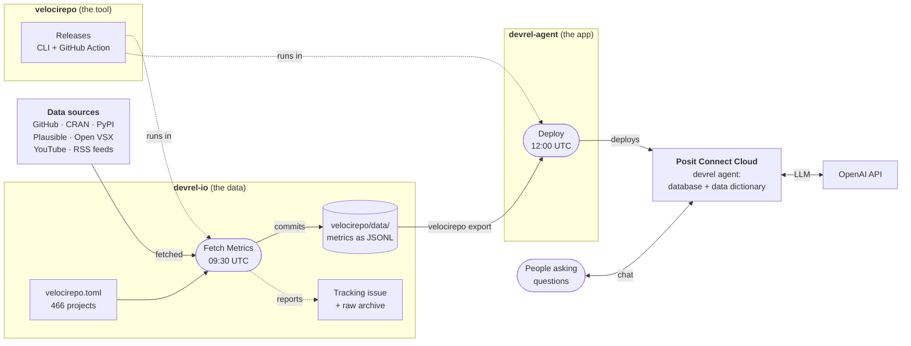
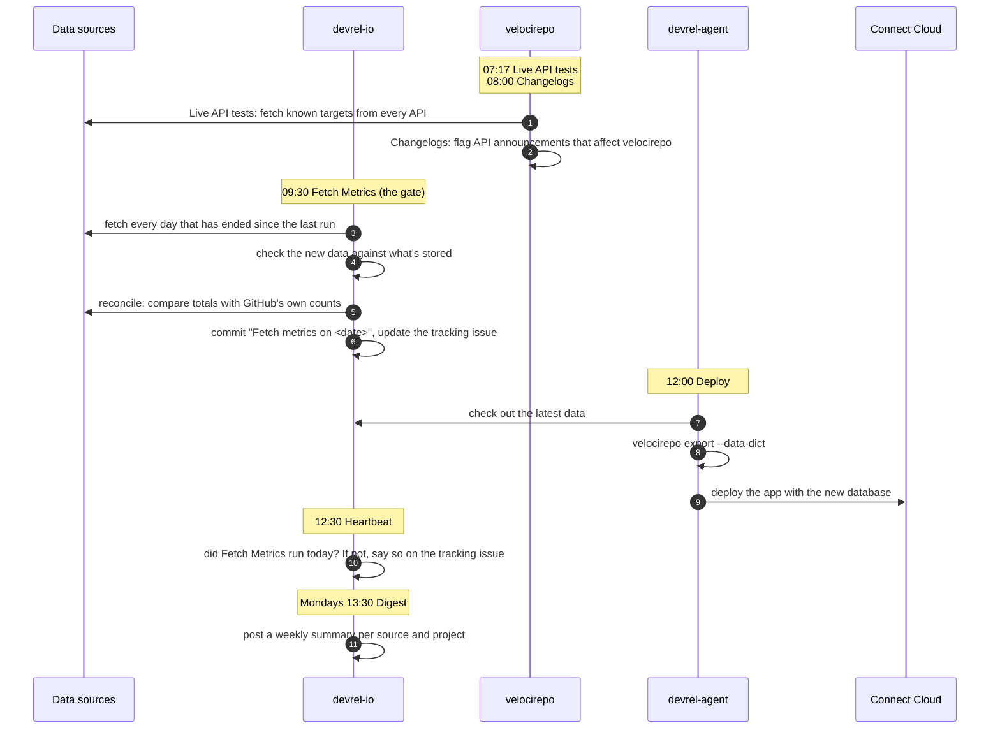
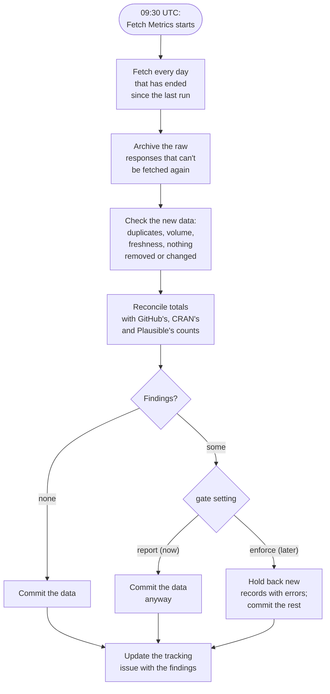
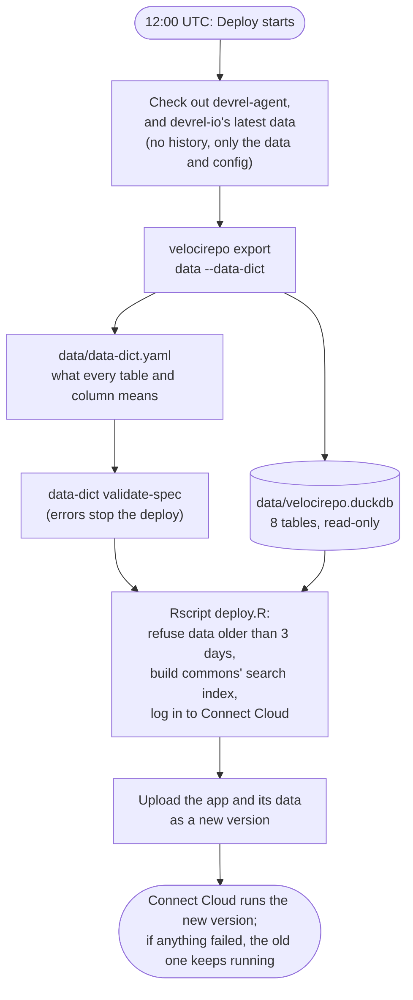

# How velocirepo, devrel-io and devrel-agent fit together

Posit's developer relations team tracks how its open source projects are doing: downloads, website traffic, GitHub activity, videos, blog posts. Three repositories do this together, each with its own job:

| Project | What it is | Where it runs |
|---|---|---|
| [**velocirepo**](https://github.com/posit-dev/velocirepo) | The **tool**: a command-line program (written in Go) and a GitHub Action. It fetches metrics from APIs, stores them as plain files in a Git repository, checks that they're right, and exports them as a database with a description of the data. It knows nothing about Posit: anyone can use it for their own projects. | On GitHub Actions runners, and on laptops |
| [**devrel-io**](https://github.com/posit-dev/devrel-io) | The **data**: a Git repository that holds the configuration (`velocirepo.toml`, which lists 466 projects and where to find their metrics) and every metric collected so far (`velocirepo/data/`, as JSON Lines files). velocirepo adds to it every night. | GitHub |
| [**devrel-agent**](https://github.com/posit-dev/devrel-agent) | The **app**: a chat assistant (an R Shiny app built on [commons](https://github.com/posit-dev/commons)) that answers questions about the data, such as "how many CRAN downloads did dplyr have last month?". It reads a database that velocirepo exports from devrel-io, and asks an LLM to write the queries. | Posit Connect Cloud |

In one sentence: **velocirepo** collects the metrics into **devrel-io** every night, and **devrel-agent** answers questions about them.

## The big picture

How to read it: the data flows from left to right, along the solid arrows. Every morning, devrel-io's Fetch Metrics workflow queries the APIs for the projects in `velocirepo.toml` and commits the results to devrel-io. At noon, devrel-agent's Deploy workflow turns those results into a database with a description of the data (the data dictionary, which also uses notes in `velocirepo.toml`) and deploys the app with it to Connect Cloud, where people chat with it. The dashed arrows are the supporting roles: both workflows run velocirepo, and the nightly run reports problems on a tracking issue.

## A day in the life

Every workflow, in the order it runs. All times are UTC.

### Every workflow

| Repository | Workflow (file) | When | What it does |
|---|---|---|---|
| devrel-io | **Fetch Metrics** (`velocirepo.yml`) | 09:30 daily, and by hand | Runs velocirepo's *gate*: fetches the new data, checks it, commits it, archives what can't be fetched again, and keeps the tracking issue up to date. By hand, it can also repair a range, or release or discard data that was held back. |
| devrel-io | **Check the nightly run** (`velocirepo-heartbeat.yml`) | 12:30 daily | Checks that Fetch Metrics ran. GitHub silently stops scheduled workflows in repositories without activity for 60 days; this notices. |
| devrel-io | **Weekly digest** (`velocirepo-digest.yml`) | Mondays 13:30 | Posts a summary of the week to an issue, with a sparkline per source and project, and marks projects that stopped. |
| devrel-agent | **Deploy** (`deploy.yml`) | 12:00 daily, by hand, and on pull requests | Exports devrel-io's latest data with velocirepo, checks it, and deploys the app to Connect Cloud. Pull requests run everything but the deploy. |
| velocirepo | **CI** and **CI Docs** | On pull requests and pushes | Tests the code; builds the documentation site. |
| velocirepo | **Release** | When a version tag (`v1.3.1`) is pushed | Builds the binaries, publishes them on GitHub and PyPI, and moves the `v1` tag that devrel-io's workflows use. |
| velocirepo | **Live API tests** | 07:17 daily | Fetches known targets from every API, so that an API change is noticed before it reaches anyone's data. |
| velocirepo | **Changelogs** | 08:00 daily | Flags changelog entries of those APIs that mention an endpoint velocirepo uses. |

## Inside the nightly gate

The Fetch Metrics workflow is where data enters. velocirepo's gate makes sure that a night only ever *adds* data, and that problems are noticed.

A day "has ended" in the source's own time zone: US Pacific for GitHub's star history, each site's time zone for Plausible, UTC otherwise. The raw responses go into release assets named `raw-YYYY-MM` in devrel-io; reconciliation checks a seventh of the repositories each night, so each one once a week. The commit is called "Fetch metrics on" the date of the run.

Today the gate only *reports*; after two quiet weeks it will *enforce*, holding back new data that fails a check until someone looks at it. False positives are accepted in `velocirepo/checks.toml` in devrel-io.

## Inside the deploy

### What the agent knows

The exported database has eight tables:

| Table | One row per |
|---|---|
| `projects` | project in devrel-io's `velocirepo.toml` |
| `targets` | project, source and target (a package, repository, site, …), and which copy counts when two projects track the same target |
| `metrics` | project, source, target, metric and day, such as the CRAN downloads of dplyr on 2026-10-20 |
| `metrics_filled` | the same, with running totals carried forward to every day |
| `indicators` | metric and day: 28-day growth and trend |
| `events` | GitHub event: an issue opened, a pull request merged, a comment |
| `content` | issue, pull request, repository, video, blog post or other item, with its text |
| `meta` | export: the date the data runs through |

`data-dict.yaml` describes all of it in the [data-dict](https://data-dict.tidyverse.org) format. velocirepo writes it from four things: the schema, what each source declares about its data, the data itself (examples, ranges, coverage), and the `[data_dict]` section of devrel-io's `velocirepo.toml`, where people write down what velocirepo can't know, such as days that are missing or which project keeps a shared website. The agent reads it before it writes a query; it's what keeps it from, for example, summing running totals over days.

## Where to change what

| You want to … | Change … |
|---|---|
| Track a new project, package or website | `velocirepo.toml` in **devrel-io** (or `velocirepo add-project`). It's fetched from the next night on. |
| Tell the agent about a quirk of the data | The `[data_dict]` section of `velocirepo.toml` in **devrel-io**. The next deploy carries it. |
| Fix a problem the tracking issue reports | Repair it with a manual run of Fetch Metrics in **devrel-io** (`repair: <source>/<project> <from>..<to>`), or accept a false positive in `velocirepo/checks.toml`. |
| Change how metrics are fetched, checked or exported | The code in **velocirepo**, then a release: devrel-io's workflows pick up a release through the `v1` tag; devrel-agent's Deploy workflow pins a version, so bump it there. |
| Change the app: its look, questions, instructions | **devrel-agent**. The next deploy carries it. |
| Run the agent on your own machine | **devrel-agent**'s README, "Run it locally". |

## Secrets, and who holds what

| Where | Secret | For |
|---|---|---|
| devrel-io | `GH_TOKEN`, `PLAUSIBLE_TOKEN`, `YOUTUBE_TOKEN` | Fetching from GitHub, Plausible and YouTube. CRAN, PyPI, Open VSX and the RSS feeds need no token. |
| devrel-agent | `CONNECT_CLOUD_CLIENT_ID`, `CONNECT_CLOUD_CLIENT_SECRET` | Deploying to Connect Cloud from the Deploy workflow |
| Connect Cloud, the app's Variables | `OPENAI_API_KEY` | The agent's LLM, at runtime. It never passes through GitHub. |

## Status (2026-10-22)

- The gate runs on devrel-io since 2026-10-22, reporting only; enforcing is planned from about 2026-11-05.
- devrel-agent's Deploy workflow can't log in to Connect Cloud yet (`invalid_client`); until that's solved, the app on Connect Cloud is deployed by hand and runs an older version of the data.
- More detail: velocirepo's user guide (<https://posit-dev.github.io/velocirepo>), and the plans in `docs/design/`: the [data dictionary](design/2026-10-data-dict.md), [devrel-agent's nightly deploy](design/2026-10-devrel-agent-deploy.md) and [the gate's rollout on devrel-io](design/2026-10-devrel-io-rollout.md).
